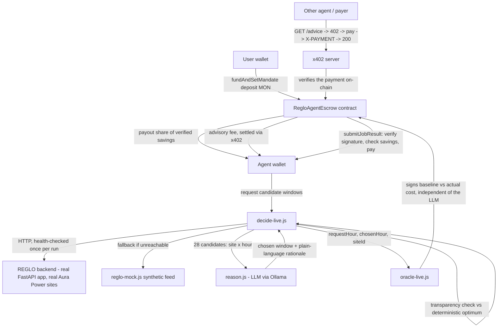
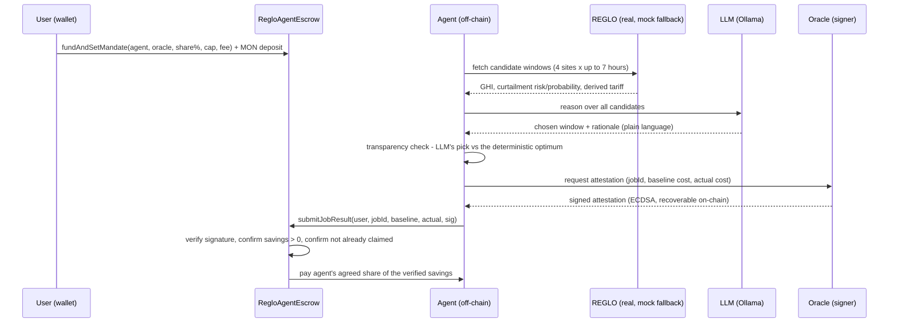
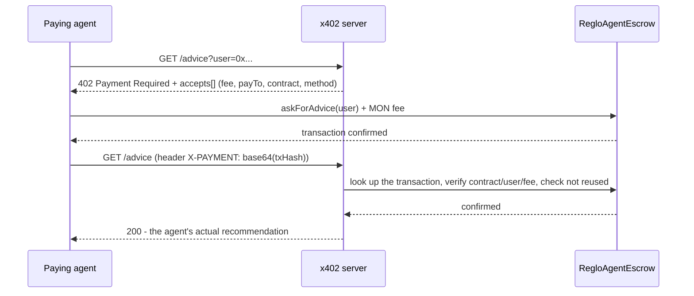

# REGLO Agent — Metropolis (Monad) Hackathon Submission

**Track:** Physical AI Infrastructure
**Deadline:** 14 Oct, 04:59 GMT+1

## One-line pitch

An AI agent earns MON for proving — on-chain, against real grid data —
that it saved money by timing compute around cheap, curtailed solar power.

## The idea

REGLO Agent is a self-paying AI agent built for Monad's Physical AI
Infrastructure track. It schedules deferrable compute jobs into cheap,
low-curtailment power windows — verified against REGLO, a real
solar-curtailment monitoring platform (live Aura Power site data:
Rayleigh, Kemble, Burtree Lane, Grimsby) — and gets paid automatically in
MON the moment it proves it saved money, with no human in the approval
loop.

The flow: a user funds an on-chain mandate (`RegloAgentEscrow.sol`) naming
an agent and a trusted oracle. The agent pulls REGLO's real curtailment
forecasts, and calls Qwen or Kimi — both verified end-to-end with real
on-chain payouts — to reason over the candidate windows and pick one,
falling back to a local Ollama model or a deterministic rule if neither
API is reachable. Its choice is logged against the deterministic
cost-optimal pick for transparency. An oracle signs an attestation of
baseline-vs-actual cost; the contract verifies the signature on-chain and
pays the agent its share of the verified saving — automatically.

The agent also sells its scheduling advice to other agents over a real
x402 HTTP flow (402 → on-chain MON payment → verified retry → advice),
settled directly against the escrow contract since no Monad x402
facilitator exists yet. A live, self-contained dashboard reads the escrow
contract directly from the browser, showing the running balance and every
real event and transaction as it happens.

Everything above is live on Monad testnet today: real contract, real
REGLO data, real LLM calls (Qwen and Kimi, both verified), real payout and
x402 transactions — not a mockup.

## Architecture

## The core workflow

Two deliberate design points worth a judge's attention:

1. **The LLM only picks WHICH window to act on — it never touches the
   numbers that decide payout.** The oracle independently re-derives
   baseline/actual cost from REGLO's data and signs that; the contract
   checks `actualCost < baselineCost` itself. A bad or hallucinated LLM
   answer can at worst mean a smaller (or zero) saving, never a wrong
   payout.
2. **The transparency check is logged on every run.** If the LLM's pick
   isn't the true cheapest option, the agent says so out loud — e.g. "LLM's
   pick saves 20p — 30p left on the table" — rather than quietly accepting
   whatever the model said.

## The x402 payment layer

The agent also sells its advice directly, per question, to other agents —
a real x402 flow (HTTP 402 → `accepts[]` → on-chain payment → `X-PAYMENT`
header → 200), not a simulated one:

One honest adaptation: x402's reference facilitators settle in USDC on
Base. There's no x402 facilitator for Monad yet, so settlement here is a
real MON transaction calling the escrow's `askForAdvice()` directly rather
than going through a third-party facilitator. The HTTP protocol shape is
exactly as specified; the settlement rail is what's actually live on Monad
today.

## Proof of life (Monad testnet)

Contract: [`0xfDB3B28a35a6E9f4A73166086480f0726E1aB1C4`](https://testnet.monadscan.com/address/0xfDB3B28a35a6E9f4A73166086480f0726E1aB1C4)

- Full real-data run — real REGLO backend, **Qwen** LLM reasoning
  (`REASONING_PROVIDER=qwen`), transparency check, oracle-verified payout:
  [`0x666c6090caba0282d6b96c148c6206cd0778635eb2f2131e0a063ee77c99b09a`](https://testnet.monadscan.com/tx/0x666c6090caba0282d6b96c148c6206cd0778635eb2f2131e0a063ee77c99b09a)
- Earlier full real-data run — real REGLO backend, LLM reasoning,
  transparency check, oracle-verified payout:
  [`0x7e92191c8b8bfbae2905cfa4255ca4d53eef5df147df8580206b2b7e3737cd57`](https://testnet.monadscan.com/tx/0x7e92191c8b8bfbae2905cfa4255ca4d53eef5df147df8580206b2b7e3737cd57)
- x402 advisory payment — real 402 → on-chain payment → verified retry:
  [`0xda2cfe8f34051e2277c38db5ceafcd80880bd50bbd1e7128aeed3a74832c25e6`](https://testnet.monadscan.com/tx/0xda2cfe8f34051e2277c38db5ceafcd80880bd50bbd1e7128aeed3a74832c25e6)

## Bounty integrations

- **Monad** — the escrow/mandate/payout contract is deployed and live on
  Monad testnet; every tx linked above is real.
- **Qwen (Alibaba Cloud DashScope)** — the agent's reasoning provider in
  `agent/reason.js` (`REASONING_PROVIDER=qwen`), verified end-to-end
  against real REGLO data with a real on-chain payout (see tx above).
- **Kimi (Moonshot AI)** — same code path as Qwen (`REASONING_PROVIDER=kimi`),
  sharing the OpenAI-compatible chat-completions call in `agent/reason.js`.
  Also verified end-to-end against real REGLO data with a real on-chain
  payout:
  [`0xcc5f99ebfccb2a9128a102984f5ddde4d22d67c9b4268bc9b42201e058b8e438`](https://testnet.monadscan.com/tx/0xcc5f99ebfccb2a9128a102984f5ddde4d22d67c9b4268bc9b42201e058b8e438)
  Writeup: [How Kimi Powers REGLO Agent's On-Chain Decisions](https://dev.to/edmundjeevan/how-kimi-powers-reglo-agents-on-chain-decisions-3cne)

## What's real, and what's honestly still a placeholder

| Piece | Status |
|---|---|
| Escrow / mandate / payout contract | Real, deployed and tested on Monad testnet |
| Agent decision logic | Real LLM call (local Ollama), deterministic fallback if unreachable |
| REGLO data feed | Real FastAPI backend (actual Aura Power site data, actual curtailment-detection math), with a synthetic fallback if that backend isn't reachable |
| Oracle attestation | Real signed-attestation pattern (same approach production price oracles use); signed by one demo key rather than a key REGLO's backend itself controls |
| x402 advisory payment | Real HTTP 402 flow with on-chain payment verification; settles in MON rather than through a USDC/Base facilitator, since Monad has none yet |
| Pence → MON conversion rate | A placeholder constant for demo-sensible numbers, not a real price feed |
| Cross-chain funding (Aurora/NEAR Intents) | Researched, confirmed real on Monad **mainnet** via NEAR Intents (e.g. SwapKit) — not built, since this project runs on testnet and intents networks don't support testnets (no real value to incentivize a solver) |

## Tech stack

Solidity (OpenZeppelin ECDSA, pinned to v4.9.6 / Shanghai EVM target —
deliberately conservative since Monad's exact supported fork isn't
confirmed in public docs), Hardhat 2, ethers.js v6, Node.js, Qwen / Kimi
(OpenAI-compatible APIs) for agent reasoning with a local Ollama and
deterministic fallback, Python/FastAPI for the real REGLO backend, and a
hand-built x402 server/client over plain Node `http`.

## What's next

Swapping the single-oracle-key pattern for multiple independent attestors;
a real pence↔MON price feed; REGLO's own backend signing attestations with
a key it controls; and, once an x402 facilitator exists for Monad,
dropping the direct-contract-call workaround in favor of it.
